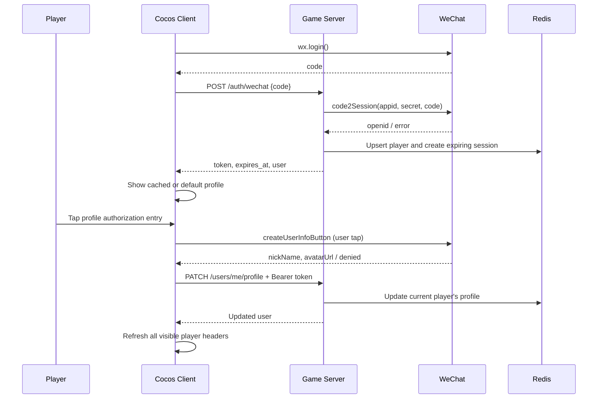

# 微信小游戏登录与玩家资料接入计划

日期：2026-10-30  
状态：待实施的接入方案；本次仅新增计划文档，未修改业务代码。  
后端：`/Users/gang.xu/go/src/github.com/BeyongTheMemory/fc_server`  
客户端：`/Users/gang.xu/cocos/five_card`

## 1. 本次目标与边界

打通 `wx.login → 后端校验微信身份 → 签发业务登录凭据`，并在玩家主动授权后，将头像、昵称显示到游戏、商店、结算页左上角的玩家信息区域。

本次交付：

- 同一微信账号在同一小游戏 AppID 下，多次登录、不同设备登录均对应同一个后端玩家 ID。
- 登录接口不要求玩家同时授权头像昵称；未授权时返回“无名”和默认头像状态。
- 玩家主动点击授权后更新自己的资料；拒绝、取消、网络失败均不阻塞单机游玩。
- 成绩上传和“我的排名”从服务端登录态确定玩家身份，不能继续信任客户端自报的 `user_id`。
- 本地缓存玩家资料和业务 token；缓存资料仅用于显示，不能作为服务端认证依据。

保持用户已确认的存档规则：当前对局仍保存“小关开始时的快照”。商店购买、抽奖领奖后退出回退到小关入口是有意设计，**本次不增加这些操作后的进度落盘**。玩家资料与登录缓存独立于 `five_card_save_v1`，不随新开一局或恢复关卡快照而清除。

本次不实现云端存档、跨设备游戏进度同步、历史匿名成绩合并、手机号登录、支付、完整反作弊。原 `specs/001` 的 US3 只有“微信身份识别”部分在本次提前实施，其云存档恢复部分仍待后续实现。登录只能验证提交者身份，不等于验证其上报成绩真实。

## 2. 仓库现状与具体缺口

以下结论基于当前工作区，包括现有尚未提交的排行榜改动；实施时应保留这些改动。

| 当前文件 | 已有能力 | 本次需要补充的内容 |
|---|---|---|
| `main.go` | Gin 路由 `/upload_score`、`/fetch_rank`，统一 `{code,msg,data}` 响应 | 登录/资料路由、Bearer 鉴权、401/403/429/502/503/504 错误映射 |
| `internal/domain/person/application/user_application.go`、`impl/user_application_impl.go` | 只有 package 声明 | 玩家登录、资料查询/更新、会话校验的应用服务 |
| `internal/domain/person/entity/person.go` | `ID int64`、姓名、创建/登录时间、预留存档字段 | 与排行榜 `string` ID 对齐，增加微信归属和头像资料 |
| `internal/processor/dto/user_info.go` | 客户端提供 `user_id`、`user_name`、地区 | 登录后身份由服务端提供；拆分地区输入与玩家身份 |
| `internal/processor/upload_score.go`、`fetch_rank_list.go` | 直接把请求体里的玩家 ID 传入排行榜 | 改用认证上下文中的玩家 ID，昵称取玩家资料 |
| `internal/config/config.go` | 环境变量配置 Redis、MySQL、端口等 | 微信凭据、上游超时、业务会话有效期 |
| `internal/initer.go` | Redis/排行榜/MySQL 同步器装配 | 微信客户端、玩家存储、会话存储和应用服务装配及关闭 |
| `internal/util/gin_logger.go` | 完整记录每次请求体和响应体 | 登录前必须改造，避免记录 code、token、微信密钥或个人资料原文 |
| `internal/infrastructure/sync/rank_mysql_sync.go` | 只备份最高分，在线链路不访问 MySQL | 玩家资料需要单独备份，不能假设现有最高分表会保存登录身份和头像 |
| `internal/processor/fetch_ongoing_game.go` | 空文件 | 本次保持未实现，不借登录接入扩展云存档 |

客户端也有两个实际缺口：

- `assets/common_component/user_info_component.ts` 只在启动时设置昵称；`onUserInfoUpdate()` 尚未订阅事件，头像没有远程加载实现。
- `game_presentation.ts` 给原头像叠加了固定水墨头像，`result_presentation.ts` 隐藏原头像后另建固定头像。只调用 `GameData.setUserPic()` 不会改变截图中的最终画面，需统一玩家信息展示组件。

## 3. 技术选择与架构约束

遵循 `.specify/memory/constitution.md` v1.1.0，继续使用 Go 1.24、Gin、go-redis/v9、zap，以及现有 Redis 在线存储、MySQL 异步备份方式。

调用关系：

```text
Gin route / auth middleware
  → processor + explicit DTO
  → domain/person application
      → WechatIdentityProvider interface ← infrastructure/wechat HTTP client
      → PlayerRepository interface      ← infrastructure Redis implementation
      → SessionRepository interface     ← infrastructure Redis implementation
```

- 微信 HTTP 调用用标准库 `net/http`，随机数/哈希用 `crypto/rand`、`crypto/sha256`，不新增 OAuth SDK、JWT 库或 ORM。
- Domain 不依赖 Gin、Redis、SQL。鉴权中间件调用应用服务，不直接操作 Redis。
- Redis 复用现有连接，由 `internal/initer.go` 注入；新模块不各建一套连接或通过随意添加的全局变量装配。
- Redis 中保存随机业务 token 的会话，便于过期、退出和多设备并存。第一版不做 refresh token，过期后重新 `wx.login`。
- `AppSecret` 只存在于后端运行配置。`openid`、`session_key` 不作为客户端登录凭据，不出现在公开响应和排行榜里。
- 本次不解密微信用户资料：前端用 `withCredentials: false` 获取已授权的公开资料，后端仅接收用于展示的昵称和头像 URL。`code2Session` 返回的 `session_key` 不持久化、不返回客户端。

### 稳定玩家 ID

建议使用固定的确定性算法：

```text
user_id = "wx_" + base64url_without_padding(SHA256("v1\0" + appid + "\0" + openid))
```

结果为 46 个 ASCII 字符，可装入现有 `VARCHAR(64)` 和排行榜 ID 长度限制。同一 `(appid, openid)` 始终生成同一 ID，Redis 丢失后重新登录也不会分裂成新身份；算法标识和分隔方式写入契约并固定测试向量。它只是玩家标识，**不是鉴权凭据**。

`Person.ID` 改为 `string`；实施时全仓确认引用，目前未发现该 int64 身份被已上线接口使用。不同 AppID（如测试号与正式号）产生不同身份，不自动把两个账号的成绩或资料合并。

## 4. 登录与授权流程



流程细则：

1. 客户端有未过期 token 时可先请求 `/users/me`；401 时重新获取微信 code，再登录一次，禁止无限重试。
2. 后端只使用配置中的 AppID、AppSecret，不允许客户端指定凭据或传 `openid` 直接登录。微信 code 有效期为 5 分钟，不能缓存成长期凭证；重复/失效 code 不得新建可信会话。
3. 同一次前端登录只保留一个在途请求。上游交换超时后不盲目重放旧 code；需要重试时由客户端重新 `wx.login` 取新 code。
4. 登录成功不会自动获得头像昵称，也不触发头像授权弹窗。登录与授权失败分别呈现和处理。
5. 首次资料授权需用户主动点击原生 `wx.createUserInfoButton`，并按小游戏后台要求配置隐私保护指引；不能用 `wx.authorize({scope: 'scope.userInfo'})` 代替该点击授权流程。已授权可按官方流程调用 `wx.getUserInfo` 刷新，不能仅靠无限期本地缓存。
6. 拒绝资料授权后仍可保留业务登录态，并以默认资料使用受保护接口；当前用户信息接口失败时不清除游戏进度。
7. 业务 token 过期不代表玩家撤销头像授权；微信授权状态与业务会话独立处理。

## 5. HTTP 接口草案

沿用 `{ "code": 200, "msg": "", "data": ... }` 包裹，`code` 与 HTTP 状态保持一致。所有接口都定义独立 DTO，不直接序列化 Domain 实体。实施时固化到 `specs/002-wechat-login/contracts/http-api.md`。

### POST /auth/wechat

无需业务 token。请求只接受登录 code，设置请求体大小上限和 code 长度上限（建议 16 KiB 请求体、1 KiB code）。

```json
{ "code": "wx.login 返回的新 code" }
```

成功示例：

```json
{
  "code": 200,
  "msg": "",
  "data": {
    "token": "随机生成的业务会话令牌",
    "expires_at": 1793923200,
    "user": {
      "user_id": "wx_<固定算法生成的玩家ID>",
      "nickname": "无名",
      "avatar_url": ""
    }
  }
}
```

`expires_at` 为服务端计算的 Unix 秒时间戳。示例值仅说明类型。重复登录返回相同 `user_id`、已有玩家资料和新的会话；不把已授权资料覆盖成默认值。新会话不使其他设备的会话失效。

### GET /users/me

要求 `Authorization: Bearer <token>`。返回当前玩家的 `user_id`、`nickname`、`avatar_url`。不接受查询参数指定另一名玩家，不暴露微信内部凭据。

### PATCH /users/me/profile

要求 Bearer token，仅更新当前认证玩家；请求不含 `user_id`。

```json
{ "nickname": "玩家昵称", "avatar_url": "https://<微信返回的头像地址>" }
```

- 昵称建议允许 1～64 个 Unicode 码点，拒绝控制字符；显示宽度由前端省略处理，不破坏 emoji 编码。排行榜从服务端资料构造身份时不再套用旧请求 DTO 的 32 字符昵称校验；资料存储和排行榜转换统一使用新限制。地区字段继续保留现有 `|` 分隔符校验。
- 头像 URL 长度建议不超过 2,048 字节，校验 HTTPS、合法主机及禁止 URL 内嵌凭据。空头像允许回退默认图。
- 第一版不由服务端抓取或代理头像，不把外部 URL 变成服务端下载能力。客户端实际加载的头像域名仍需满足微信下载域名要求。
- 这两个字段是客户端授权后提交的**展示资料**，并不构成对微信资料真实性的密码学证明；修改它们不会改变 `user_id` 或获得额外权限。
- 重复提交相同资料不增加版本号，不重复标脏。资料保存成功后返回与 `/users/me` 一致的用户对象。

### POST /auth/logout

要求 Bearer token，删除当前 token 对应的会话；不注销其他设备、不删除玩家记录、不清理本地对局存档，也不等同于撤销微信资料授权。

### 现有排行榜接口的调整

保留 `/upload_score`、`/fetch_rank` 路径和现有响应字段，但两者均要求 Bearer token；请求中的 `user_info` 仅用于地区信息。新客户端请求示例：

```json
{
  "user_info": {
    "location": { "province": "浙江省", "city": "杭州市", "district": "西湖区" }
  },
  "score": 1000
}
```

`/fetch_rank` 不含 `score`。兼容期若收到旧 `user_id`、`user_name` 字段，可接受但必须忽略，身份和昵称只能来自认证上下文及玩家资料，不能回退到请求体。地区仍沿用当前前端自报语义，不从微信资料推断区县或默认申请定位。

这是鉴权语义的破坏性变化：旧客户端不带 token 将返回 401。更新旧文档、测试和 curl 示例，并与客户端同步切换；不能留下另一条匿名写入相同排行榜的入口。历史匿名 ID 暂不合并或删除，后续是否清理测试榜单另行处理。

排行榜昵称继续采用“最近一次成绩上报时刷新”的既有规则；本次头部资料更新立即生效，但不新增一次改名同步所有历史榜单的机制，也不增加榜单头像字段。

### 错误行为

| 情况 | HTTP / code | 客户端处理 |
|---|---:|---|
| 参数格式、长度或资料内容非法 | 400 | 显示可读错误，不自动重复提交 |
| token 缺失、无效、过期；微信 code 无效（40029） | 401 | 重新获取 code 并登录；最多自动恢复一次 |
| 微信风险拦截（40226） | 403 | 提示暂不可登录，单机继续 |
| 微信调用限流（45011）或本服务限流 | 429 | 等待后再试，禁止重试风暴 |
| 请求体超限 | 413 | 修正请求 |
| 微信响应非预期、JSON 错误、配置鉴权错误 | 502 | 通用服务错误，详细安全诊断留服务端 |
| Redis/本地依赖不可用 | 503 | 不伪装为登录成功，不签发无法校验的 token |
| 微信调用超时 | 504 | 提示重试；下次使用新 code |

微信响应即使 HTTP 200 也需检查 `errcode`，并要求成功结果包含非空 `openid`。`unionid` 是可选字段，不能作为首次登录必填条件。原 `handleServerError(err.Error())` 不应原样返回认证上游错误：错误字符串可能携带含 secret/code 的请求 URL。

## 6. Redis、会话与玩家资料备份

### Redis 数据

| Key | 内容 | 生命周期 |
|---|---|---|
| `player:{user_id}` | HASH：appid、openid、nickname、avatar_url、created_at、last_login_at、updated_at、revision | 无业务 TTL |
| `auth:session:{sha256(token)}` | user_id、appid、issued_at、expires_at | 默认 7 天，配置化 |
| `player:dirty` | HASH：user_id → 最新待同步 revision | 成功备份并按版本确认后删除 |

- token 用 `crypto/rand` 生成至少 32 字节，再做 base64url 编码；Redis key 只存其哈希，不在日志/数据库保存明文 token。
- 会话属于明确 AppID；校验时同时核对当前服务的 AppID。测试环境和正式环境使用独立 Redis DB/实例，避免共享排行榜、会话与资料。
- 创建玩家、仅初始化缺失资料、更新登录时间、增加 revision 与标脏由 Lua/等价原子操作完成；并发首次登录不会产生两个玩家，也不会覆盖同时更新的昵称头像。
- 默认 7 天为业务会话策略，不是假定微信 `session_key` 有相同有效期。每次请求都由 Redis 会话校验，不能把 token 当永久 ID。
- 身份验证失败不访问下游成绩写入；Redis 失败不切换为“信任请求 body”的降级逻辑。
- 登录入口增加有限速的尝试保护，限流键设置 TTL；按可信来源 IP 限流，反向代理来源必须显式配置，不能信任任意 `X-Forwarded-For`。

### MySQL 持久备份

沿用在线 Redis、后台 MySQL 的现有架构，新增 `player_profile` 表，至少包含：

- `user_id VARCHAR(64)` 主键；`appid VARCHAR(64)`、`openid VARCHAR(128)`，对 `(appid, openid)` 建唯一索引，并使用区分大小写的比较规则。
- `nickname VARCHAR(64)`（utf8mb4）、`avatar_url VARCHAR(2048)`；创建/登录/更新时间及 `revision BIGINT`。
- 业务会话不备份到 MySQL；Redis 会话丢失后重新登录即可。头像保存 URL，不保存图片二进制。

新增玩家资料同步器，而不是把头像塞进 `user_best_score`。可复用现有同步周期配置和数据库连接生命周期；SQL 与后台任务均留在 infrastructure。`MYSQL_DSN` 未设置时仍可本地测试登录，只告知当前没有资料持久备份。

新同步任务不要直接照搬现有“先弹出脏集合”的方式：先读取待处理 revision 和玩家快照，MySQL 仅接受更新版本，提交成功后用 Lua 比较 revision 再清理脏标记。并发改资料、数据库失败或任务崩溃不能丢掉待同步更新。

恢复需先从 MySQL 重建玩家资料（保留 revision），再开放登录/资料写入，避免空 Redis 从 revision=1 开始覆盖较新的备份。会话不恢复。MySQL 异步备份只能保证已同步的数据；备份间隔内 Redis 故障仍可能丢失最新资料，不能宣称零数据丢失。固定 ID 算法保证重新登录的身份归属稳定。

## 7. 配置、日志与运行方式

| 配置 | 建议值/要求 |
|---|---|
| `WECHAT_APP_ID` | 当前测试或正式小游戏的 AppID，由后端固定配置 |
| `WECHAT_APP_SECRET` | 与上述 AppID 配套，后端秘密环境变量注入，不写源码/文档/前端 |
| `WECHAT_HTTP_TIMEOUT` | 默认 `5s`，启动时检查为正值 |
| `AUTH_SESSION_TTL` | 默认 `168h`，启动时检查合法范围 |
| `PORT` | 本地联调使用 `8081`；现有静态资源服务器占用 `8080` |
| `REDIS_*`、`MYSQL_DSN`、`RANK_SYNC_INTERVAL` | 复用现有配置，测试/正式隔离 |
| `REBUILD_PLAYER_FROM_DB` | 恢复操作时开启；重建完成后再接收请求 |

接入版本运行时必须校验微信配置完整；单元测试通过注入 fake provider/session repository 运行，不依赖真实密钥。没有真实配置时可以做前端模拟展示和单元测试，不能运行公开的“任意 code 即登录”后门。

日志改造先于开放登录路由：

- `RequestResponseLogger()` 改为记录方法、路径、状态、耗时、请求 ID 和有限安全字段，取消默认完整请求体/响应体捕获。认证相关请求不记录 Authorization、code、token、session_key、AppSecret、openid 或资料原文。
- 上游失败记录操作名、分类错误、微信 errcode，不记录完整请求 URL，也不直接记录可能携带 URL 的原始 `url.Error`。
- 登录/资料接口返回 `Cache-Control: no-store`；限制请求体应在可能读取整个 body 的中间件之前执行。
- 后端正式部署走 HTTPS，并在小游戏后台配置 API 的 request 合法域名。头像下载按实际微信头像域名和客户端下载方式配置。
- H5 预览如跨域，使用明确的开发 Origin 白名单，允许 Authorization/Content-Type 和 OPTIONS；微信原生请求不依赖浏览器 CORS。

本地联调拓扑：

```text
127.0.0.1:8080 → 现有 Cocos 远程资源服务
127.0.0.1:8081 → fc_server HTTP API
127.0.0.1:6379 → Redis（本地业务默认 DB 0，自动化集成测试使用独立 DB）
```

手机测试用电脑的局域网 IP，不能把手机上的 `127.0.0.1` 当电脑地址。测试号能否完成真实登录/资料授权需要检查其后台能力、配套凭据及隐私配置；目前只验证了测试号运行游戏，尚未验证完整认证链路。更换正式 AppID 后重新登录，不复用测试身份数据。

## 8. 文件级改动清单

以下为实施时的拟定落点，不代表文件已经新增。

| 路径 | 修改内容 |
|---|---|
| `main.go`、`main_test.go` | 新路由、认证分组、错误映射、请求体限制；用 fake 服务测试完整 HTTP 链路 |
| `internal/config/config.go`、`config_test.go` | 新环境变量、必填/有效范围校验，避免静默吞掉错误认证配置 |
| `internal/initer.go` | 显式装配微信客户端、person 服务、Redis 会话/玩家存储和资料同步器，统一关闭资源 |
| `internal/domain/person/entity/person.go` | string ID、微信身份、昵称头像、时间和资料版本；存档预留字段不参与本次接口 |
| `internal/domain/person/entity/session.go`（新增） | 业务会话及认证结果 |
| `internal/domain/person/application/user_application.go`、`impl/user_application_impl.go` | 登录、查本人、改本人资料、会话校验与退出 |
| `internal/domain/person/provider/wechat_identity.go`（新增） | 微信身份兑换接口，支持 fake 隔离外部调用 |
| `internal/domain/person/repository/player.go`、`session.go`（新增） | 存储无关的玩家和会话接口 |
| `internal/infrastructure/wechat/client.go`（新增） | 有超时的 code2Session 客户端、响应限制、错误分类和安全错误文本 |
| `internal/infrastructure/repository_impl/player_redis_storage.go`、`session_redis_storage.go`、`person_keys.go`（新增） | 原子 upsert、token 哈希存储与 TTL、资料版本和脏标记 |
| `internal/infrastructure/sync/player_mysql_sync.go`（新增） | 玩家资料建表、版本化增量备份、恢复和优雅关闭 |
| `internal/processor/wechat_login.go`、`current_user.go`、`update_profile.go`、`logout.go`（新增） | 参数校验与应用服务调用 |
| `internal/processor/middleware/auth.go`（新增） | Bearer 解析、通过应用服务认证、向 processor 传递强类型的已认证身份 |
| `internal/processor/dto/wechat_login.go`、`player_profile.go`（新增） | 明确的请求/响应结构 |
| `internal/processor/dto/user_info.go`、`upload_score.go`、`fetch_rank_list.go` | 保留地区输入，移除客户端身份/昵称必填和可信语义 |
| `internal/processor/upload_score.go`、`fetch_rank_list.go` 及测试 | 使用登录身份；构造领域 UserInfo 时读取服务端昵称 |
| `internal/util/gin_logger.go` 及新增测试 | 请求元数据日志、敏感内容不落日志 |
| `README.md`、`specs/002-wechat-login/` | 配置、认证契约、旧接口兼容性说明、联调步骤和任务拆分 |

排行榜积分算法、Lua 只升不降、周/月窗口和排序规则原则上复用。身份校验从接口边界接入，不重写这些逻辑。

## 9. Cocos 前端需要配合的修改

| 路径（相对 five_card） | 修改内容 |
|---|---|
| `assets/auth/wechat_auth.ts`（拟新增） | 微信登录、业务 token 管理、单次在途登录、401 恢复；Web 预览独立 mock |
| `assets/auth/player_profile.ts`（拟新增） | 玩家资料缓存、更新事件、缓存与 AppID/玩家身份绑定 |
| `assets/network/api_client.ts`（拟新增） | 独立 API base URL、Bearer、HTTP/业务错误处理，资源服务器配置不混用 |
| `assets/meta_data/global_data.ts` | 使用既有 userName/userPic 字段，资料更新统一通知；重置对局不清账号资料 |
| `assets/const/event.ts` | 新增用户资料更新事件 |
| `assets/common_component/user_info_component.ts` | 订阅/注销事件、远程头像加载、长昵称适配、失败回退默认图 |
| `assets/main_page/game_presentation.ts` | 固定水墨头像作为默认图，不再永久覆盖真实头像 |
| `assets/shopping_page/shop_presentation.ts` | 使用同一头像/昵称展示逻辑 |
| `assets/result_page/result_presentation.ts` | 移除另建固定头像的独立逻辑，让截图所示位置响应真实资料更新 |

授权入口建议放在玩家头像区域，明确显示同步头像昵称的用途。原生授权按钮的坐标/尺寸按微信窗口与 Cocos Canvas 坐标转换，场景切换、弹窗遮挡、切后台时隐藏或销毁，避免透明按钮覆盖其他功能。

异步头像加载时检查节点仍有效、当前玩家/URL 未变化，避免旧请求覆盖新头像。动态图片使用等比裁切，加载失败保持默认头像；缓存图片不写进游戏进度 JSON。客户端临时获取到资料但后端同步失败时可以先显示，记录待同步状态；该状态不等于后端已持久化。

## 10. 实施顺序与验收

### P0：固化契约与联调前置

- 从本计划生成 `002/spec.md`、`contracts/http-api.md`、`tasks.md`，标明当前需求对 `001` 身份与资料授权描述的调整。
- 确认测试号/正式号配套凭据、资料授权能力、隐私配置；配置本地后端 8081 与独立测试数据环境。
- 确认 API 认证切换窗口；没有旧客户端部署证据前，不假设可以静默改变线上契约。

验收：接口字段、错误行为和存档边界明确；缺少微信配置不会阻塞代码设计/单元测试，但真机登录验收须等配置齐备。

### P1：身份、存储与微信客户端

- 新增配置校验、稳定 ID 算法、person 应用与存储接口、Redis 玩家/会话实现。
- 用 `httptest.Server` 验证 code2Session 成功与失败；真实上游基地址不对客户端开放。
- 先改日志与错误脱敏，再允许认证接口注册。

验收：同一身份稳定、并发登录不覆盖资料；会话有 TTL，Redis 故障不会签发有效登录结果；secret/code/token 不出现在测试捕获日志中。

### P2：HTTP 登录与资料、排行榜鉴权

- 实现四个认证/资料接口和中间件；改造两个排行榜接口的身份来源。
- 保持响应包裹、排名排序和积分幂等；更新既有调用方、测试与 README 示例。

验收：A 的 token 携带 B 的 user_id 也不能给 B 上传成绩或读取 B 的“我的排名”；资料授权被拒绝不影响已验证身份；无 token 无法写榜。

### P3：前端展示和授权

- 接入微信登录/资料授权、缓存和统一头像组件，覆盖游戏/商店/结算三处。
- 保留默认形象、失败重试和单机入口；不改小关存档时机。

验收：真实授权后截图所示区域刷新；拒绝授权、昵称过长、图片失效、切换场景期间回调均不破坏界面；重新开局不清昵称头像；商店/领奖退出回退仍按原设计。

### P4：资料备份与恢复、完整联调

- 实现玩家资料 MySQL 版本化备份和启动前恢复，单测可先完成，MySQL 联调由测试 DSN 驱动。
- 使用可管理账号完成开发工具及手机真机认证；验证同 AppID 下两台设备得到相同玩家 ID，头像刷新与本地进度各自独立。

验收：备份失败可重试，并发更新不丢脏标记；恢复后身份不变，过期/丢失会话重新登录；未配置 MySQL 时明确仅依赖 Redis 持久性，不声称具备资料备份。

### 自动化检查矩阵

- Provider：非 200、超时、取消、无效 JSON、超大响应、HTTP 200 + errcode、缺少 openid、无 unionid、配置错误。
- Application/Redis：首次/重复/并发登录、资料默认值不覆盖已有资料、多个设备会话、token 失效、退出、资料重复更新、依赖故障。
- HTTP：参数校验、无/假/过期 token、伪造其他 user_id、错误状态包裹、响应 no-store、请求体限额、限流；日志不含机密与个人资料原文。
- Rank：原有最高分、幂等、地区、时间窗口、同分排序测试保持通过；新增认证后身份来源回归测试。
- Sync：失败重试、提交后崩溃重放、旧版本不覆盖新版本、并发更新后仍待同步、恢复完成前不接收写入。
- Frontend：授权同意/取消/拒绝、已授权刷新、401 重登一次、网络中断不阻塞单机、头像加载竞态、三个页面显示一致、存档行为保持不变。

实施完成后的仓库门禁：`gofmt`、`go build ./...`、`go vet ./...`、`go test ./...`。Redis 集成测试沿用现有隔离测试库策略，不碰开发 DB 0；MySQL 集成测试只连接显式 `TEST_MYSQL_DSN`。任何外部环境导致的跳过需在报告中列明。当前仅写计划，未运行这些实现验收测试。

## 11. Constitution Check

| 原则/约束 | 本方案 |
|---|---|
| I. 分层 | HTTP 适配、领域应用、外部身份 provider、存储实现分离；依赖指向 domain |
| II. 契约优先 | 先固化 DTO、错误表与旧排行榜鉴权变化，再实现 |
| III. 行为测试 | fake provider/repository、httptest、Redis/MySQL 集成和客户端回归各覆盖对应边界 |
| IV. 日志 | 复用 zap，先修复完整 body 日志，认证错误仅记录安全分类信息 |
| V. 依赖纪律 | 使用标准库及现有依赖，不新增直接依赖 |
| Redis/MySQL | Redis 在线读写、MySQL 只异步备份和受控恢复；未新增存储引擎 |

本计划不要求修订项目宪法。异步备份的恢复点限制需如实保留，不能将其描述为强一致持久存储。

## 12. 实施前仍需提供的信息

1. 要使用的小游戏账号及其 AppID；确认可以管理该账号后台。AppSecret 由用户放进后端秘密配置，不要求粘贴到聊天或仓库。
2. 测试号实际支持的登录/资料授权能力和隐私配置情况；目前尚未完成真实头像授权验证。
3. 正式 API 域名与部署方式可稍后确定；本地先用 `8081`，后续需要 HTTPS 和合法域名配置。
4. 如要验收 MySQL 资料备份，提供隔离测试实例的配置方式；无 MySQL 时先验收 Redis 登录链路。

资料授权入口、7 天业务会话、默认玩家资料等采用本文建议值，属于实施默认方案，不需要为了撰写计划逐项等待确认。涉及真实账号认证、隐私设置或发布的操作在实施时按实际权限处理。

## 13. 官方依据

本次已核对以下微信文档；接口细节以实施时官方文档和账号实际能力为准。

- [wx.login](https://developers.weixin.qq.com/minigame/dev/api/open-api/login/wx.login.html)：临时 code 与服务端兑换，code 有效期 5 分钟。
- [小游戏 code2Session](https://developers.weixin.qq.com/minigame/dev/api-backend/login/api_code2session.html)：服务端 HTTPS 参数、openid/session_key/可选 unionid 及主要错误码。
- [小游戏用户信息获取](https://developers.weixin.qq.com/minigame/dev/guide/open-ability/user-info.html)：首次主动授权、已授权刷新和隐私配置要求。
- [wx.createUserInfoButton](https://developers.weixin.qq.com/minigame/dev/api/open-api/user-info/wx.createUserInfoButton.html)：原生按钮及 `withCredentials` 行为。
- [测试号](https://developers.weixin.qq.com/minigame/dev/devtools/sandbox.html)：测试号管理、开发工具和真机预览；不据此假设所有认证能力已经验证。
- [网络通信](https://developers.weixin.qq.com/miniprogram/dev/framework/ability/network.html)：HTTPS、合法域名与本地调试限制。
